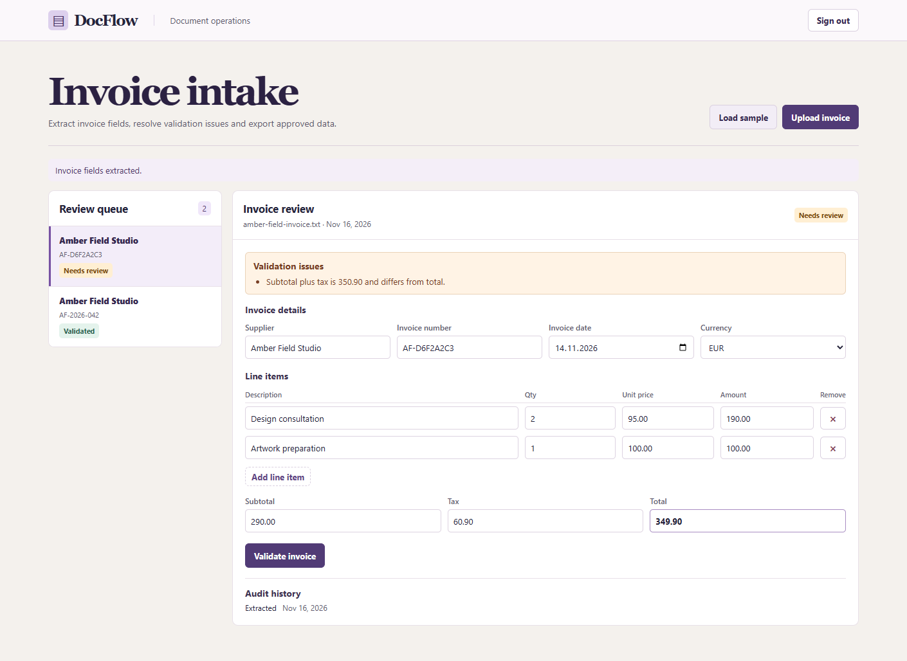

# DocFlow

DocFlow turns labeled invoices into validated records. An operator uploads a PDF or UTF-8 text invoice, checks the extracted fields, corrects any discrepancies and exports the reviewed data as JSON or CSV.



## Run locally

Use Python 3.12, Node.js 22.14+ and npm. Build the frontend before starting the backend so FastAPI can serve both on the same origin.

```powershell
python -m venv .venv
.venv/Scripts/python -m pip install -r requirements-dev.txt
npm --prefix web ci
npm --prefix web run build
Copy-Item .env.example .env
.venv/Scripts/python -m uvicorn document_flow.app:from_env --factory --env-file .env --host 127.0.0.1 --port 8012
```

On Linux and macOS, use `.venv/bin/python` and `cp .env.example .env`. For frontend development, run the backend and `npm --prefix web run dev`. Vite proxies the API to port 8012.

Open [http://127.0.0.1:8012](http://127.0.0.1:8012) and choose **Load sample**. The invoice has a deliberate total error. Set **Total** to `350.90`, select **Validate invoice**, and download either export. The same [sample file](samples/invoice.txt) can be uploaded manually.

## API

| Endpoint | Behavior |
| --- | --- |
| GET `/api/documents` | Lists up to 100 recent documents and their review states. |
| POST `/api/documents` | Receives the raw document bytes with `Content-Type: application/pdf` or `text/plain` and a percent-encoded `X-Filename` header. A byte-identical replay returns the existing record. |
| POST `/api/documents/{id}/review` | Receives `{"version": 1, "invoice": {…}}` with corrected fields. Rejects stale versions and inconsistent invoices. |
| GET `/api/documents/{id}/export?format=csv` | Downloads the validated record. Use `format=json` or omit the format for JSON. |

The document endpoints require an operator bearer token. The local demo uses `docflow-local-demo`. API schemas are available at `/docs`.

## Configuration and deployment

| Setting | Behavior |
| --- | --- |
| `DEMO_MODE` | Enables the default loopback demo credential and sample button when set to `true`. |
| `OPERATOR_TOKEN` | Set a random token of at least 32 characters and disable demo mode for deployment. |
| `DATABASE_URL` | Defaults to `sqlite:///data/docflow.db`. Use `postgresql+psycopg://…` for PostgreSQL. |
| `MODEL_API_KEY`, `MODEL_NAME`, `MODEL_ENDPOINT` | Optional Chat Completions integration for short notes about existing validation issues. With no key, there are zero model calls. |

To run with Compose, add a URL-safe random `DOCFLOW_DB_PASSWORD` to `.env` and run `docker compose up --build`. The app is exposed on loopback. For external access, use TLS and request limits at the reverse proxy.

## Verification

```sh
python -m pytest -q
python -m ruff check document_flow tests
npm --prefix web run build
python -m pip_audit -r requirements-dev.txt
npm --prefix web audit --audit-level=moderate
```

The default tests use temporary SQLite databases and generate synthetic PDFs in memory. Set `DOCFLOW_TEST_DATABASE_URL` to a dedicated PostgreSQL test database with permission to create schemas to run the same cases on a server. GitHub Actions uses PostgreSQL 17.

## Scope and original work

The MVP supports the labeled invoice format shown in the sample, six currencies and single-operator review. Scanned PDFs, OCR, arbitrary invoice layouts, contract extraction and accounting system integration are outside its scope. The core flow runs on FastAPI, SQLAlchemy, Pydantic, pypdf and React. The optional model provides review notes only. [Architecture](docs/architecture.md).

Original work includes the bounded upload API, missing-field handling, exact decimal checks, replay deduplication, versioned review, audit history and safe exports. [Third-party notices](THIRD_PARTY_NOTICES.md) · [MIT license](LICENSE).
